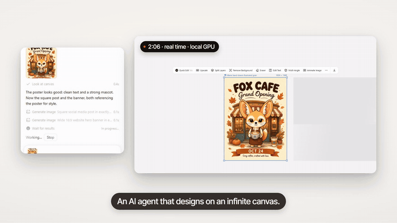

# ComfyArt

English | [中文](README.zh.md)

[Watch the full promo (38s)](docs/media/promo-en.mp4)

A free, open-source AI design canvas that runs fully on your own ComfyUI: an infinite canvas (tldraw + React), a design agent that works on it with tools, and every image and video model running locally. No account, no credits, no cloud.

## Install

Put this folder in `ComfyUI/custom_nodes/`, install the Python requirements into ComfyUI's environment (`pip install -r requirements.txt`, currently `pypdfium2` for PDF uploads), restart ComfyUI and open `http://127.0.0.1:8188/comfyart/`. The built page is in `dist/`; after changing `src/`, rebuild with `npm install && npm run build`.

Projects are saved to the ComfyUI user directory under `comfyart/projects/`. The interface follows ComfyUI's language setting (Chinese or English).

## Agent

The Agent panel runs a real tool-using agent on the backend, ported from [ComfyTV](https://github.com/jtydhr88/ComfyTV)'s bot. It is off by default: turn on MCP and the Agent in Agent Settings. Image and video modes work without it. Pick the agent per chat:

| Agent | What it needs |
|---|---|
| Claude Code | `claude` on PATH, logged in |
| Codex | `codex` on PATH, logged in |
| Qwen Code | `qwen` on PATH with a model configured in `~/.qwen/settings.json` |
| DeepSeek Harness | `dsh` on PATH, signed in through the DeepSeek Harness app |
| Local LLM | any OpenAI-compatible endpoint with tool calling (Agent Settings → Local LLM URL); set `COMFYART_LOCAL_LLM_API_KEY` before starting ComfyUI if it needs a key |

Storyboard split, OCR, brand and memory extraction, reference notes and the Ideogram caption are single calls to the default Agent (`POST /comfyart/bot/complete`, no tools). ComfyArt never stores credentials. The agent works through the ComfyArt MCP server at `POST /comfyart/mcp` (look at the canvas, generate and edit images and videos, place text, shapes, frames, web pages and slides, memory, skills, ask the user). Canvas tools are executed by the open ComfyArt tab of the project, so keep it open while the agent works. Chats are saved in a SQLite database at `user/__comfyart/data.db` and keep running when the panel is closed.

## Workflows and models

Every canvas action runs one of the API workflows in `workflows/` through ComfyUI's `/prompt`. They use core nodes unless noted.

| Action | Workflow | Models / custom nodes |
|---|---|---|
| Image generation, quick edit, edit text, expand, comment edits | `qwen-image-2.1-t2i`, `edit-qwen-image-2.1`, `outpaint-qwen-image-2.1` | `qwen_image_2.1_int8_convrot.safetensors`, `qwen3vl_8b_int8_convrot.safetensors`, `qwen_image_2.1_vae_bf16.safetensors` |
| Image generation (other models) | `z-image-turbo-t2i`, `flux2-klein-9b-t2i`, `qwen-image-2512-t2i`, `ideogram4-t2i` | `z_image_turbo_bf16` + `qwen_3_4b` + `ae`; `flux-2-klein-9b-nvfp4` + `qwen_3_8b_fp8mixed` + `flux2-vae`; `qwen_image_2512_fp8_e4m3fn` + `qwen_2.5_vl_7b_fp8_scaled` + `qwen_image_vae` (loaded with the ComfyArt Precise UNET Loader node, see below); `ideogram4_fp8_scaled` + `ideogram4_unconditional_fp8_scaled` + `qwen3vl_8b_fp8_scaled` + `flux2-vae`; the default Agent writes the structured caption Ideogram expects (`ideogram4-caption.json`) |
| Reference modes (line art, depth, pose, …) | built in code | [comfyui_controlnet_aux](https://github.com/Fannovel16/comfyui_controlnet_aux) preprocessors (MLSD, HED, normal and segmentation download their annotator weights on first use); with Qwen Image 2512 also `Qwen-Image-2512-Fun-Controlnet-Union-2602.safetensors` (controlnet) |
| Voice input | `transcribe-gemma4` | `gemma4_e4b_it_fp8_scaled.safetensors` (text_encoders) |
| Upscale | `upscale-ultrasharp-4x` | `4x-UltraSharp.pth` (upscale_models) |
| Remove background | `cutout-birefnet` | `birefnet.safetensors` (background_removal) |
| Eraser | `erase-lama` | [comfyui-inpaint-nodes](https://github.com/Acly/comfyui-inpaint-nodes), `big-lama.pt` |
| Angles | `multiangle-qwen-image-2.1` | the Qwen Image 2.1 files above, plus [`qwen-image-2.1-qma-camera-angles.safetensors`](https://huggingface.co/gribbliest/qwen-image-2.1-qma-camera-angles) (loras) |
| Split layers | `layers-qwen-image-layered` | `qwen_image_layered_bf16.safetensors`, `qwen_image_layered_vae.safetensors`, `qwen_2.5_vl_7b_fp8_scaled.safetensors` |
| Animate, video generation, video extend | `i2v-minimax-h3`, `t2v-minimax-h3` | `minimax_h3_fl2va_pruned_int8_convrot.safetensors`, `minimax_h3_fl2v_turbo_8step_v1.0_comfyui_bf16.safetensors`, `qwen3vl_32b_minimax_h3_nvfp4_awq.safetensors`, `minimax_h3_video_vae_fp16.safetensors`, `minimax_h3_audio_vae_fp32.safetensors` |
| Video trim | built in code | core nodes only |

## Nodes and routes

- `ComfyArt Precise UNET Loader` loads a diffusion model with manual cast ops. ComfyUI's `--fast fp8_matrix_mult` turns unscaled fp8 checkpoints such as Qwen Image 2512 into noise; this loader skips that path for the model it loads.
- `/comfyart/bot/*` (chats, send, stop, branch, answers), `/comfyart/settings` and `/comfyart/mcp` serve the Agent.
- `POST /comfyart/pdf` renders up to 30 pages of an uploaded PDF to PNG files in `input/comfyart/pdf/` and returns them with each page's text.

## Development

`npm run dev` starts Vite with `/api` proxied to `http://127.0.0.1:8188` (override with `COMFY_URL`).

## License

ComfyArt is MIT licensed. The Agent backend in `bot/` and `api/` is adapted from [ComfyTV](https://github.com/jtydhr88/ComfyTV)'s bot (MIT), including providers co-authored by Pengjingyu1992 (DeepSeek Harness, Local LLM, Codex), MuAIGC (Codex, Qwen Code) and Goldlionren (Codex). The canvas is the [tldraw SDK](https://tldraw.dev), which is not: it is bundled in `dist/` under its own license, copied in `licenses/tldraw-LICENSE.md`. Served from `localhost` or plain `http` it runs in development mode without a license key and shows a small "Get a license for production" badge.
